# 01 — Thermal / Plasma

**14 dari 26 gambar.** Kategori dominan dan sumber utama konsep `hero-explore-3`.

Definisi: luminance (dari field prosedural ATAU dari foto) di-remap lewat colormap termal —
hitam → violet → magenta → oranye → kuning → putih. Bukan gradien dekoratif; ini meniru citra
inframerah, sehingga terbaca sebagai **data**, bukan hiasan.

---

## Ramp warna konsolidasi — TERUKUR, bukan perkiraan

Diekstrak secara terprogram dari piksel 5 gambar acuan: setiap gambar di-downsample ke 120px,
dikelompokkan ke 8 bucket luminance, lalu diambil warna rata-rata dan persentase bidang per bucket.

| Stop | Hex | Peran | Nilai terukur pembanding |
|---|---|---|---|
| 0.00 | `#050507` | void | `#14141A` · `#140F16` · `#191022` |
| 0.13 | `#0F0A72` | indigo — **identitas Billy**, jangkar dingin | `#391494` · `#471465` · `#2D2D5D` |
| 0.28 | `#3A1A9E` | violet dalam | `#4F3DA5` · `#5A2FC2` |
| 0.43 | `#6B2FC8` | violet | `#712D94` · `#75327A` |
| 0.56 | `#A32BA8` | magenta | `#8C1BAB` · `#9A5191` · `#B84399` |
| 0.68 | `#D45C6E` | pink panas | `#D56A92` · `#C371A1` · `#D47380` |
| 0.80 | `#EE8A2A` | oranye | `#DE7147` · `#E67329` · `#F39569` |
| 0.90 | `#F5C81E` | amber | `#F3A129` · `#EEAB17` · `#F8D221` |
| 1.00 | `#FBDCC3` | **cream panas** | `#FBDCC3` · `#F6F2E6` · `#FBC294` |

**Dua koreksi penting terhadap perkiraan awal:**

1. **Magenta dan oranye datang lebih awal.** Pada luminance 0.38–0.50 referensi sudah magenta,
   bukan violet. Pada 0.50–0.62 sudah oranye/pink, bukan magenta. Ramp yang menunda panas terlalu
   lama akan terbaca sebagai gradien ungu biasa.
2. **Titik terpanas BUKAN putih murni.** Kelima acuan berakhir di cream/peach hangat
   (`#FBDCC3`, `#F6F2E6`), tidak pernah `#FFFFFF`. Ini yang memberi kesan film, bukan layar.

Varian hijau (hanya `vr-grind-thermal-face`): `#080808` → `#A020F0` magenta → `#38F048` hijau neon
→ `#3CE8C8` cyan.

---

## Distribusi bidang — ada DUA mode, bukan satu

Persentase bidang per bucket luminance, terukur:

| Gambar | Ground gelap | Violet | Magenta–pink | Oranye ke atas |
|---|---|---|---|---|
| `vr-listener-liquid-type` | **53%** | 10% | 11% | 16% |
| `vr-wegodown-thermal-arc` | **46%** | 28% | 12% | 8% |
| `vr-freedom-marble-isoline` | **40%** | 26% | 17% | 13% |
| `vr-thermal-halftone-fluid` | ~2% | **59%** | 30% | 9% |
| `vr-plasma-smooth-warp` | 2% | **53%** | 22% | 21% |

**Mode A — ground-dominant** (3 gambar pertama): hitam mengisi 40–53%, panas total ≤25%. Ini mode
untuk komposisi **yang memuat tipografi** — ruang gelap adalah tempat huruf hidup.

**Mode B — full-bleed** (2 gambar terakhir): hampir tanpa hitam, violet 53–59%. Ini mode untuk
**tekstur murni** tanpa teks.

Untuk hero web yang harus memuat masthead dan HUD, **Mode A yang berlaku.** Menerapkan Mode B pada
halaman bertipografi akan menghilangkan tempat bernapas dan membuat teks harus dipaksa terbaca
lewat shadow — yang justru dilarang aturan tipografi kategori ini.

---

## Anggota

### `vr-thermal-halftone-fluid` — referensi shader utama
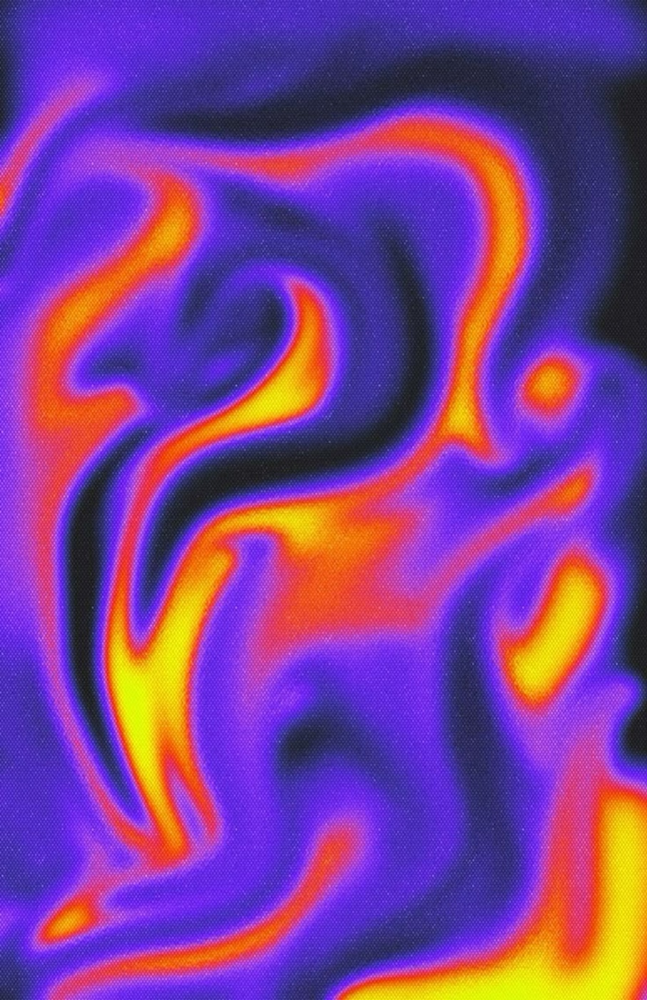

Colormap `inferno` murni pada field fluid domain-warped, dengan **halftone dot raster terlihat**
(pitch ~2px). Isoline tajam antar zona suhu. Tidak ada tipografi, tidak ada subjek — murni
material.

Ini gambar yang paling dekat dengan target `hero-explore-3`. Yang diambil: rasio zona (violet
mendominasi ~55% bidang, oranye ~25%, kuning ~12%, hitam ~8%) dan ketajaman batas antar zona.

### `vr-plasma-smooth-warp` — varian tanpa raster
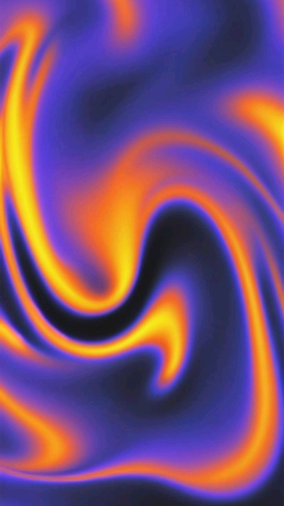

Sama, tapi tanpa halftone. Isoline lembut. Membuktikan colormap yang sama bekerja pada dua tingkat
kekasaran. Palet: `#0A0A1A` / `#4438C8` / `#7B6FE8` / `#F5711A` / `#FFC81E`.

### `vr-wegodown-thermal-arc` — knockout typography
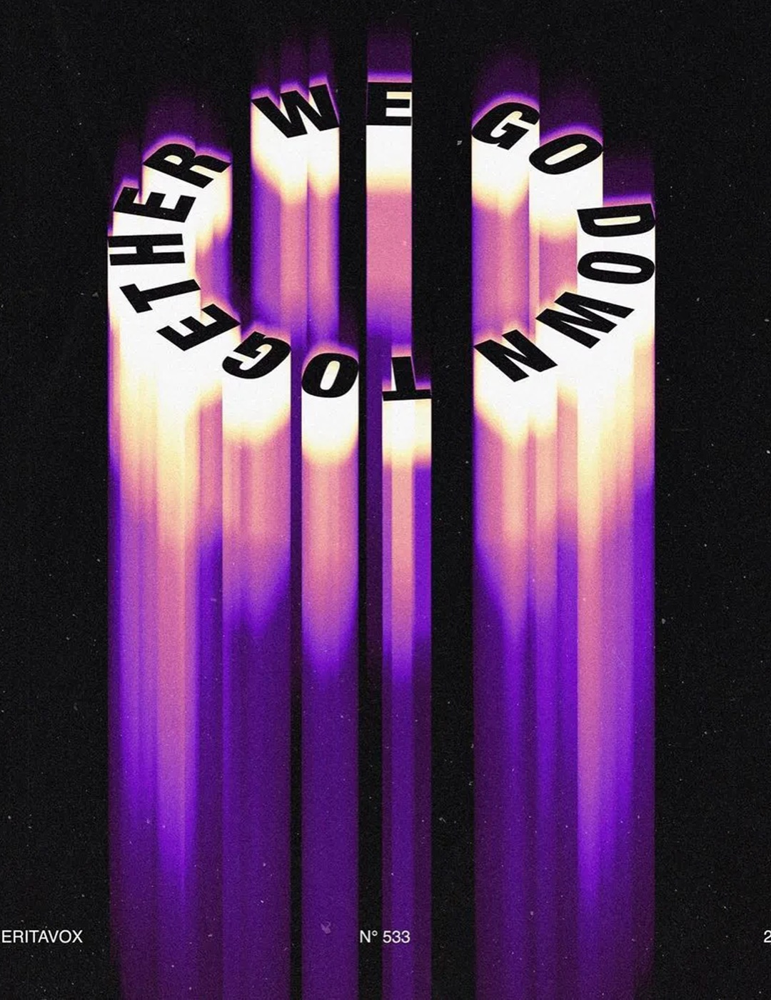

**Referensi komposisi paling penting untuk masthead.** Directional blur vertikal ekstrem (~40%
tinggi kanvas, arah tunggal ke bawah) membentuk pita cahaya berdiri. Teks grotesk kondens w800
di-set pada path melingkar 360°, warna **hitam** — sehingga huruf terbaca sebagai **lubang yang
memotong cahaya**, bukan teks berwarna.

Ini teknik yang diadopsi `hero-explore-3`: masthead `mix-blend-mode: multiply` dengan warna void,
sehingga huruf hanya terbaca penuh ketika medan di belakangnya panas.

### `vr-listener-liquid-type` — tipografi ter-warp menyatu
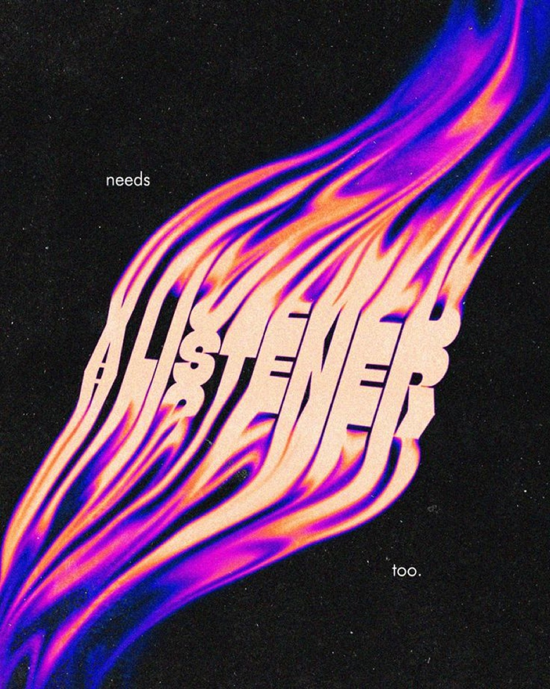

Pita plasma diagonal di atas hitam pekat. Kalimat "A LISTENER NEEDS A LISTENER TOO" di-warp
mengikuti arus, warnanya peach `#F5C9A8` — sama dengan zona panas plasma, sehingga huruf terbaca
sebagai **bagian dari cairan**. Dua kata kecil putih ("needs", "too.") ditaruh di ruang hitam
sebagai anotasi, memberi skala.

Palet: `#0A0A0A` / `#2A2AE8` biru elektrik / `#B02CE8` / `#FF5A3C` / `#F5C9A8`.

### `vr-grind-thermal-face` — potret thermal, varian hijau
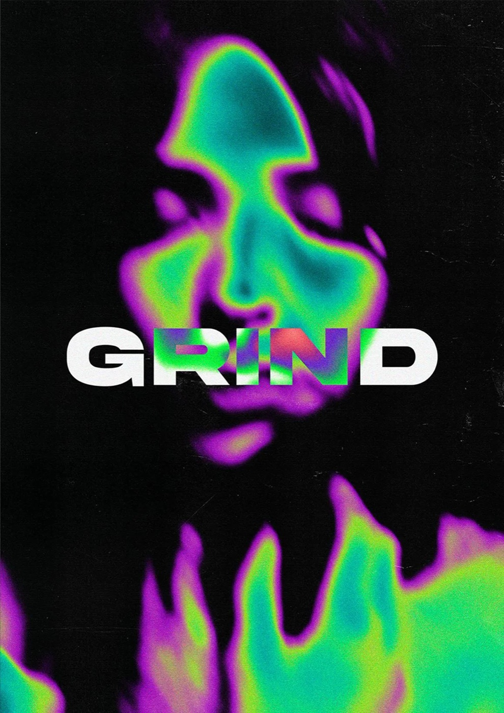

Wajah manusia diproses jadi peta panas hijau-magenta. Tipografi "GRIND" grotesk bold putih
menimpa, dan **bagian huruf yang menimpa area panas ikut mengambil warna thermal** — huruf R-I-N
sebagian hijau/merah. Bukan blend mode global; hanya di zona overlap.

### `vr-future-slitscan-face` / `vr-future-alt-thermal`
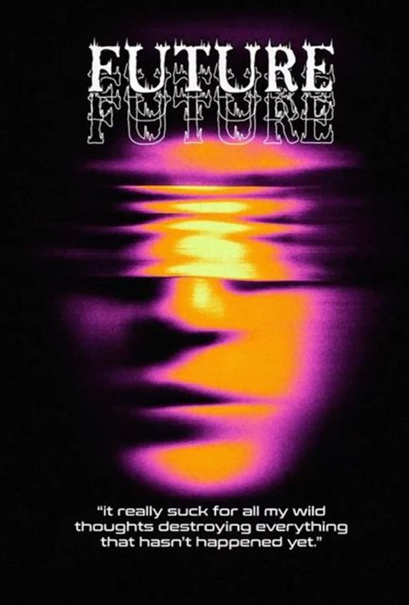

Wajah jadi peta panas dengan **slit-scan displacement horizontal** di zona mata dan mulut — baris
piksel digeser lateral dengan amplitudo bervariasi, menghasilkan pita meleleh seperti VHS tracking
error. Blur gaussian besar; tidak ada tepi tajam kecuali pada garis slice.

Judul "FUTURE" serif-gothic dirender dua kali: putih solid di atas, dan **echo outline-only** yang
ikut ter-displace oleh field yang sama.

### `vr-ignite-thermal-hands` — foto meng-oklusi tipografi
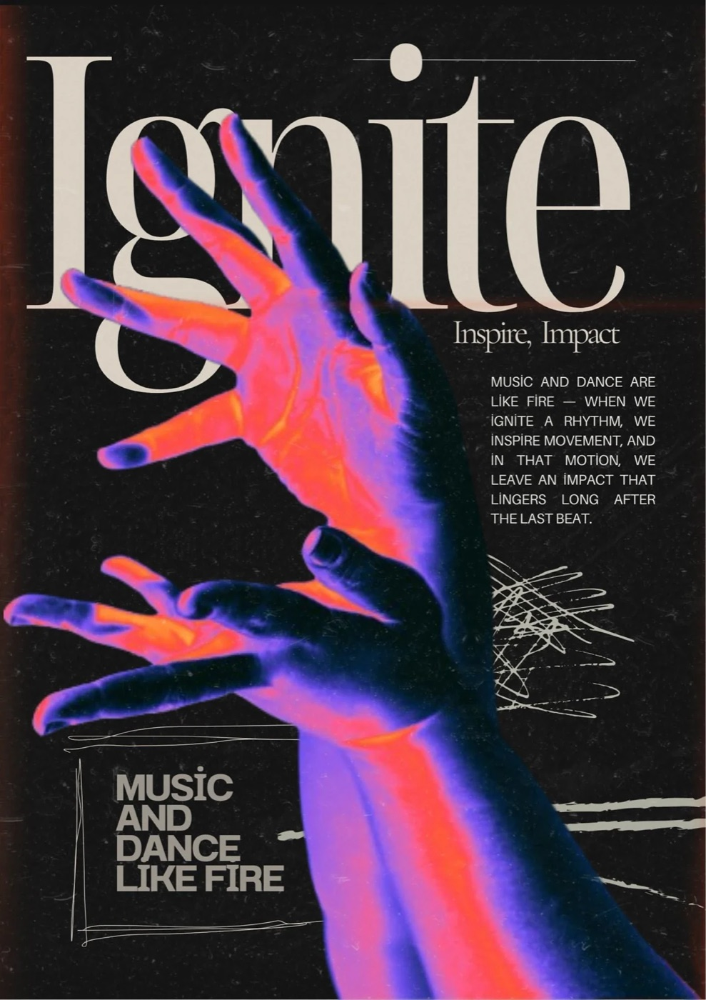

Dua tangan terentang, false-color thermal (ujung jari terpanas). Yang penting: **tangan menimpa
huruf** — ada oklusi nyata antara jari dan batang huruf "g" dan "n" dari display serif "Ignite".
Itu yang menciptakan kedalaman z, bukan drop shadow.

Palet: `#0D0A0B` / `#3A1230` / `#5B3BF0` / `#E8437E` / `#FF4B2E` / `#FF8A1F` / `#E9E4D8`.

### `vr-overheat-portrait` — HUD readout
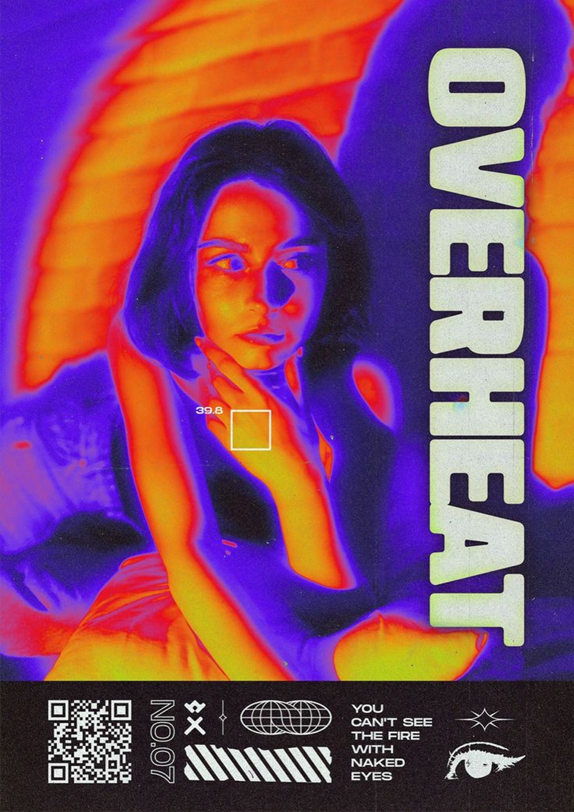

Potret thermal dengan **chromatic aberration pada tepi tipografi** (fringe lime di kiri, merah di
kanan) dan risograph misregistration. "OVERHEAT" grotesk kondens ekstra-bold dirotasi 90°.

Detail yang diadopsi: **kotak reticle 1px dengan readout angka "39.8"** — pembacaan suhu. Di
`hero-explore-3` ini jadi HUD yang menampilkan frame time nyata.

### `vr-echo-magma-portrait` — feedback buffer
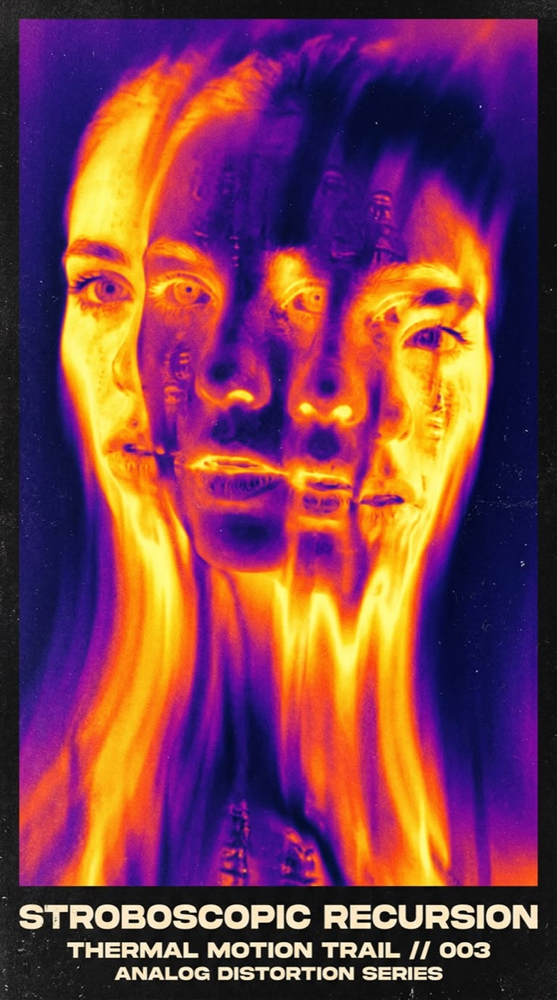

Wajah digandakan jadi 4 instans tumpang tindih horizontal lewat **echo buffer / motion trail**
(feedback loop dengan beberapa freeze tajam, seperti multi-exposure stroboskopik). Rambut meleleh
jadi pita panas vertikal di bawah.

Tipografi terpisah total — caption plate grotesk kondens di bawah bingkai, tidak menyentuh image.

### `vr-freedom-marble-isoline` / `vr-marble-isoline-a` — isoline bands
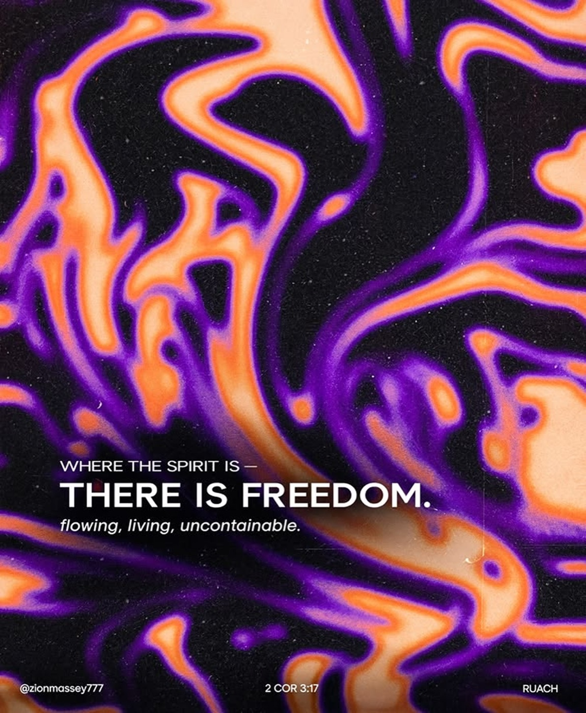

Marbling cairan dengan **posterisasi jadi isoline band tajam** — setiap band adalah kontur
equipotential (hitam → ungu → oranye → peach, berulang). Tepi band punya soft-glow ~3-4px, bukan
step murni.

Tipografi grotesk putih **datar, tegak lurus, tanpa warp** — kontras deliberate terhadap kekacauan
cairan. Layout: eyebrow uppercase tracking lebar → headline bold → subline italic → footer 3 kolom.

### `vr-memories-rimlight-fold` / `vr-memories-alt-fold` — rim-light amber
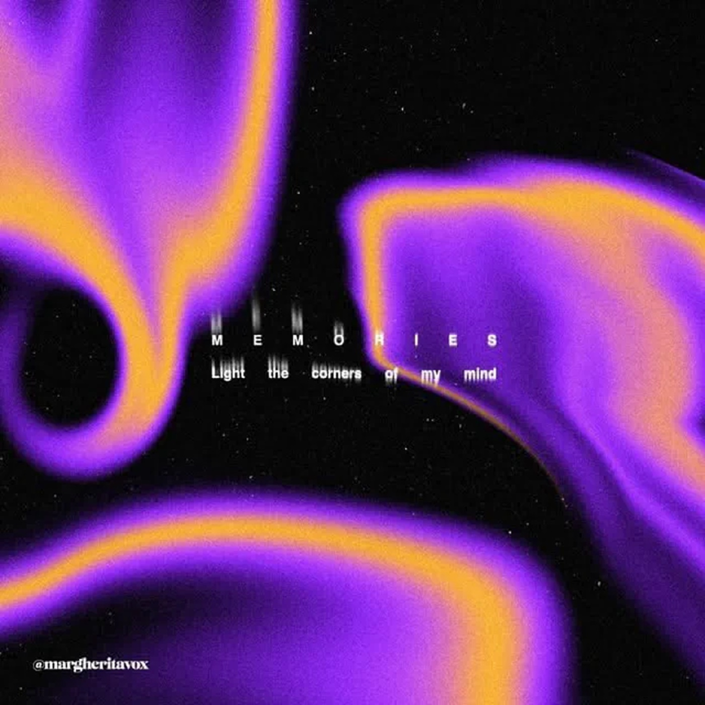

Lipatan kain/cairan dengan **rim-light**: inti violet lebar, tepi tipis oranye-amber. Bukan band
berulang — ini edge-detect gradient, garis amber hanya muncul di batas ridge.

Tipografi mono uppercase dengan tracking ~0.6em ekstrem, diberi **vertical smear ringan** sehingga
huruf berbagi perlakuan blur yang sama dengan latar — larut, bukan overlay bersih.

### `vr-plasma-alt-warp`
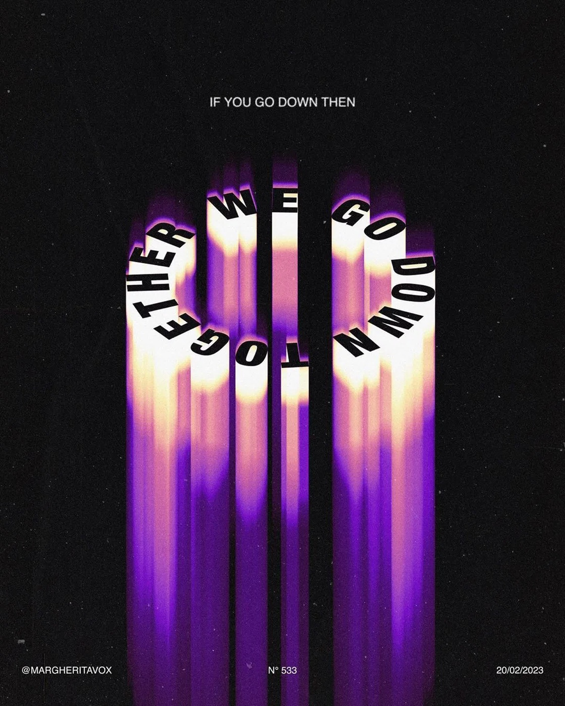

Varian domain-warp dua level dengan isoline amber tipis. Palet `#000000` / `#3D1494` / `#7B2FE0` /
`#A96BF0` / `#F5A623` / `#FFD98A`.

---

## Aturan yang diturunkan dari kategori ini

1. **Panas tidak boleh melebihi 25% bidang.** Terukur di kelima acuan: oranye-ke-atas berada di
   rentang 8–21%. Yang mendominasi adalah ground gelap (mode A, 40–53%) atau violet (mode B,
   53–59%) — tidak pernah zona panas. Kalau panas mendominasi, colormap berhenti terbaca sebagai
   pengukuran dan jadi gradien pelangi.
2. **Batas antar zona harus tajam.** Setiap gambar punya isoline yang terbaca. Gradien mulus tanpa
   kontur membuatnya terlihat seperti blur Photoshop, bukan data.
3. **Ground hitam wajib bersisa.** Tidak ada satu pun yang full-bleed panas sampai tepi; selalu ada
   hitam sebagai negative space struktural.
4. **Grain wajib.** 14 dari 14 punya film grain atau dither. Tanpa itu, gradien terlihat seperti
   CSS gradient.
