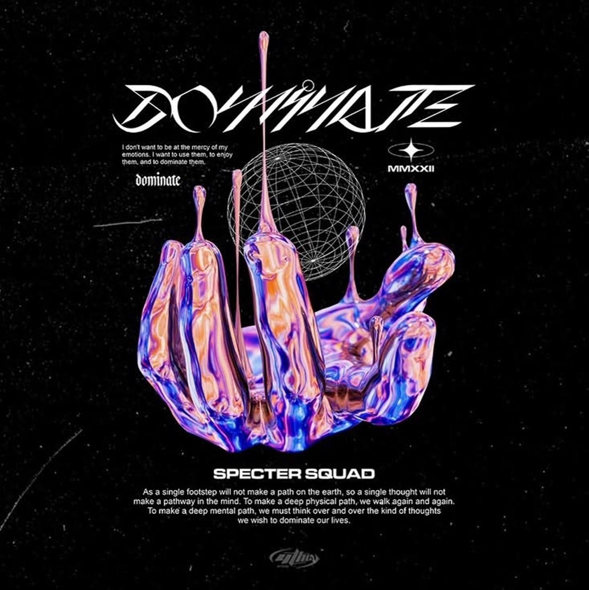
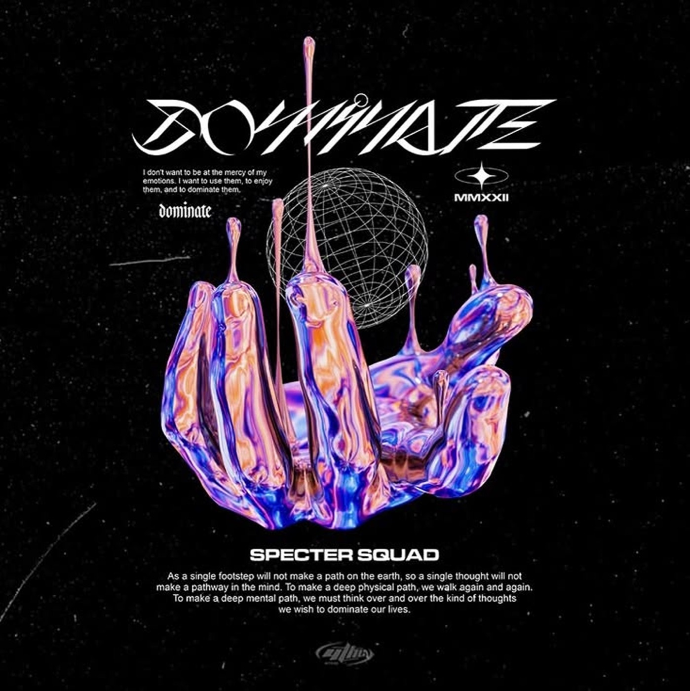
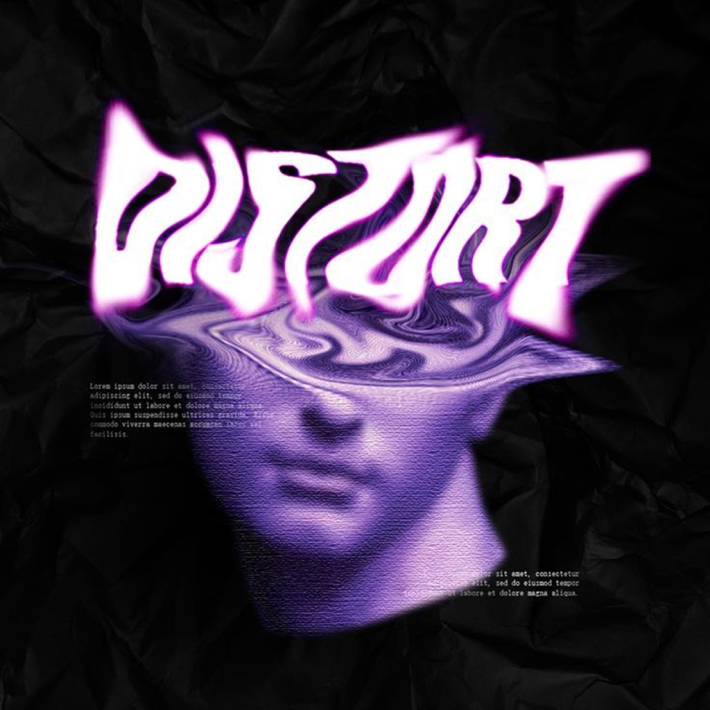

# 02 — Liquid Chrome / Iridescent

**3 gambar.** Material 3D cair dengan thin-film interference — permukaan yang memantulkan warna
berbeda tergantung sudut pandang.

Berbeda dari kategori 01: di sini warna berasal dari **material dan pencahayaan**, bukan dari
remap luminance. Yang bergerak adalah normal permukaan, bukan suhu.

---

## `vr-dominate-liquid-hand`

Tangan 3D cair, telapak menghadap atas, jari-jari menetes ke atas membentuk tarikan viskos
(tension pull) dengan strand tipis panjang. Wireframe globe garis tipis di belakang sebagai kontras
vektor terhadap organik.

- **palet** — `#070709` ground / `#2B1C6B` biru-violet dalam / `#5A3BE8` biru elektrik /
  `#B06BE8` violet / `#E89B8A` salmon-tembaga / `#F7E3D6` peach
- **teknik** — thin-film interference memetakan normal ke gradient biru↔salmon; specular tajam
  anisotropic; starfield noise sparse + goresan film halus
- **tipografi** — display blackletter di-shear dan di-slice diagonal, huruf saling berpotongan
  sampai nyaris ilegibel. **Tidak diadopsi** — sah untuk cover album, gagal untuk portofolio.
- **shader** — cosine palette pada `dot(normal, viewDir)` dengan fase RGB offset 0.0 / 0.15 / 0.35,
  plus `pow(dot(reflect, light), 64.0)`

## `vr-dominate-alt-chrome`

Varian dengan palet lebih condong ke ungu-oranye. Struktur komposisi identik: judul edge-to-edge
di atas, objek 3D mengisi ~55% tinggi tengah, blok teks di dasar, dua anotasi kecil counter-position
di kiri-atas dan kanan-atas.

## `vr-distort-liquify-statue`

Patung marmer klasik yang bagian atas kepalanya **meleleh jadi bidang cair** dengan riak
konsentris. Ditumpuk dengan display "DISTORT" yang di-liquify per-huruf sehingga terminal huruf
melar dan ujungnya lancip.

- **palet** — `#0A0A0C` / `#2A2130` / `#7A4FA8` / `#B96BE0` / `#E3B8F5` / `#FFFFFF`
- **teknik** — liquify/smudge warp radial; neon outer-glow magenta radius besar; latar **foto
  kertas kusut** sebagai bump texture (bukan noise prosedural); duotone ungu pada foto patung
- **hal yang penting** — huruf dan kepala patung ter-warp oleh **field yang sama**, sehingga
  keduanya terbaca sebagai satu material. Ini strategi (a) "tipografi menyatu" dalam bentuk paling
  murni.
- **shader** — `uv += vec2(sin(len*40.0 - t), cos(len*40.0 - t)) * ripple * smoothstep(e0, e1, uv.y)`
  diterapkan serentak pada texture teks dan texture objek

---

## Aturan yang diturunkan

- Iridescence hanya bekerja kalau ada **specular tajam**. Gradient warna-warni tanpa highlight
  terbaca sebagai gradien pastel, bukan logam.
- Objek cair butuh **kontras vektor** di dekatnya (wireframe, garis rule, grid) supaya
  keorganikannya terbaca sebagai pilihan, bukan default.
