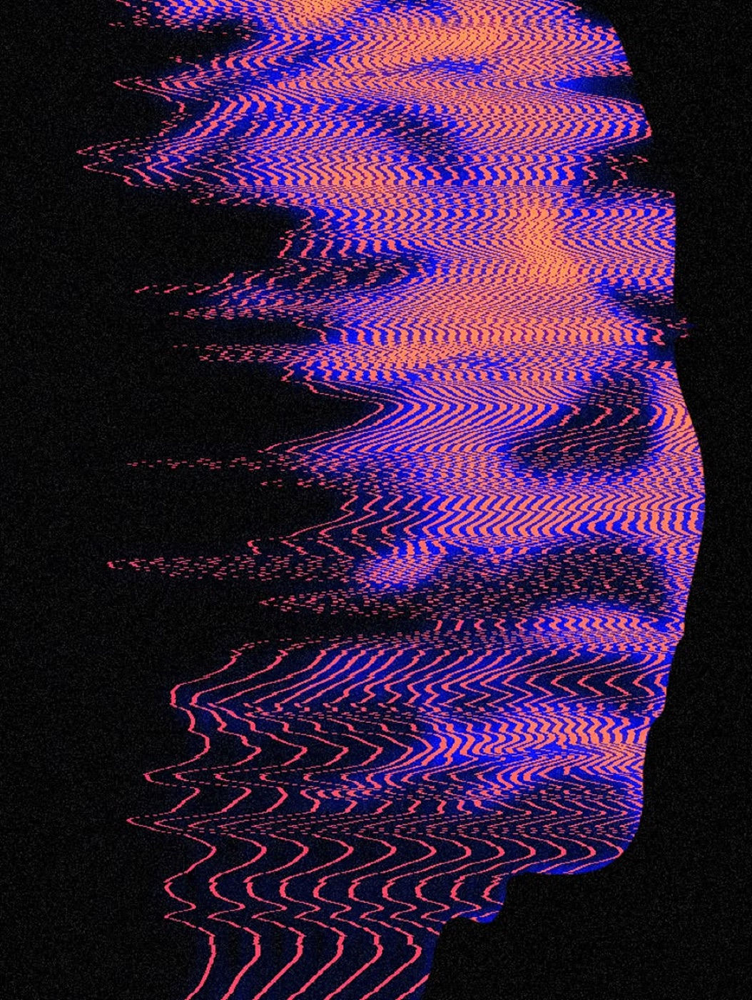
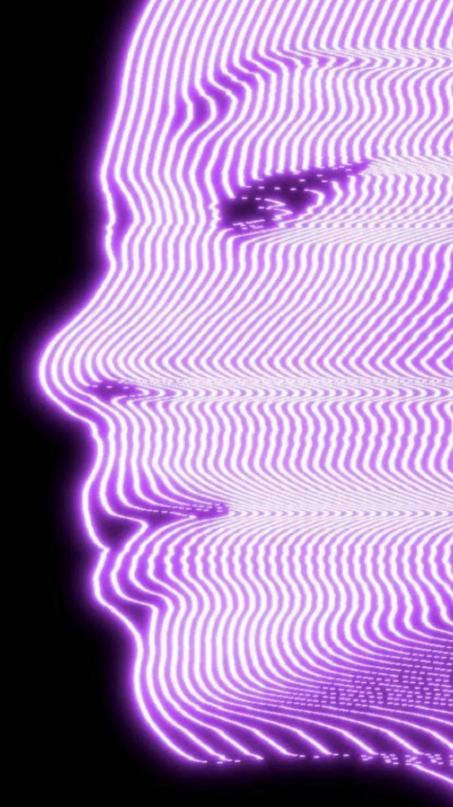

# 03 — Scanline / Contour

**2 gambar.** Siluet wajah manusia dibangun sepenuhnya dari garis kontur horizontal — tidak ada
piksel foto yang tersisa, hanya garis yang bergelombang mengikuti kedalaman.

Kategori ini penting karena menjawab pertanyaan "bagaimana memasukkan sosok manusia tanpa memakai
foto". Jawabannya: **jangan tampilkan fotonya, tampilkan pembacaannya.**

---

## `vr-scanline-face-coral`

Profil wajah menghadap kanan, dibentuk dari garis-garis zigzag horizontal rapat. Kepadatan garis
menentukan bentuk; di area latar garis meregang jadi hampir lurus, di area wajah ia berdesakan dan
bergelombang tajam.

- **palet** — `#050505` ground / `#2B2BE0` biru elektrik / `#F4674F` koral / `#FF7A63` salmon
- **teknik** — kuantisasi `uv.y` jadi N baris, lalu offset `uv.x` per baris berdasarkan luminance
  peta kedalaman; dua warna di-interleave per baris
- **komposisi** — siluet edge-anchored kanan, seluruh kiri bidang dibiarkan hitam kosong

## `vr-scanline-face-violet`

Versi mono-hue: garis violet-magenta dengan glow, wajah menghadap kiri. Garisnya lebih rapat dan
lebih halus; ada **glow bloom** di tepi siluet yang membuat profil terbaca dari jauh.

- **palet** — `#000000` / `#8B3FE8` / `#C86BE0` / `#F0D0FF`
- **teknik** — sama, ditambah outer-glow radius besar pada mask siluet

---

## Aturan yang diturunkan

- **Garis harus rapat.** Kedua gambar memakai 80–140 baris pada tinggi penuh. Di bawah ~50 baris,
  wajah tidak lagi terbaca dan hasilnya jadi pola abstrak.
- **Satu sisi bidang harus kosong.** Keduanya menaruh siluet menempel satu tepi dan membiarkan
  sisi seberangnya hitam total. Siluet di tengah dengan ruang simetris kehilangan ketegangan.
- Ini teknik yang dipilih untuk "kehadiran manusia" di `hero-explore-3` — dibangkitkan dari SDF,
  bukan dari foto.
