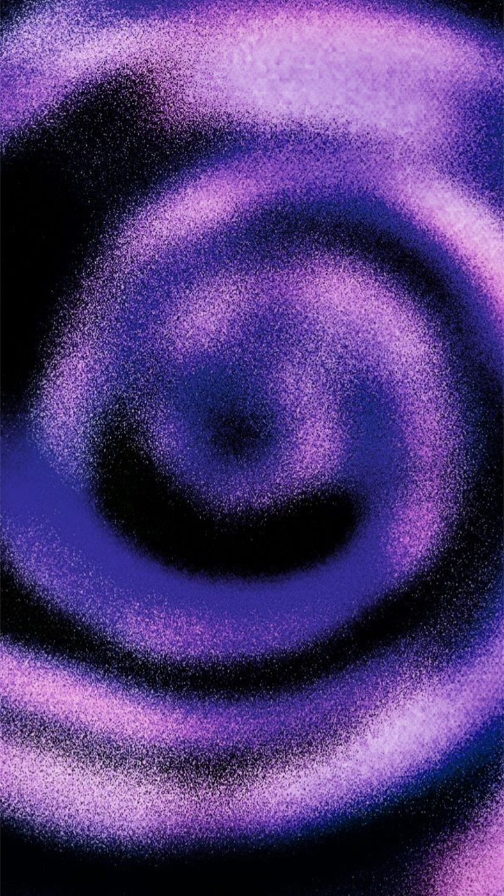
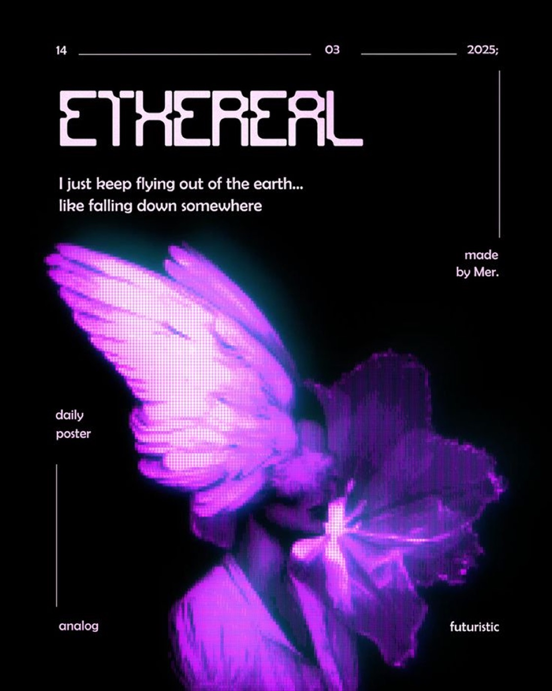

# 04 — Grainy Gradient / Halftone

**2 gambar.** Gradien yang kekasarannya adalah subjeknya sendiri.

---

## `vr-vortex-grain-violet`

Pusaran violet dengan **grain sangat kasar** (stippled/dithered, butirannya terlihat jelas sebagai
titik individual, bukan noise halus). Struktur: fbm dengan domain warping berputar, tiga cincin
konsentris yang tidak sempurna.

- **palet** — `#000000` / `#3D2BB0` indigo / `#7B4FD6` violet / `#C9A0E8` lilac
- **teknik** — fbm + domain warp radial, lalu dither ordered (bukan random) sehingga butirannya
  membentuk pola halus yang terbaca sebagai tekstur cetak
- **catatan** — tidak ada tipografi sama sekali. Ini murni tekstur; gunanya sebagai lapisan
  atmosfer di belakang konten, bukan sebagai hero.

## `vr-ethereal-halftone-wing`

Kupu-kupu/kelopak hybrid dengan **halftone dot raster kotak beraturan** (~2px pitch) di seluruh
objek, ditambah bloom pada area luminance tertinggi dan **rim-light cyan** tipis di tepi sayap
sebagai satu-satunya warna komplementer.

- **palet** — `#000000` / `#3A1470` / `#8B2BD6` / `#D14FEA` / `#2FD8CF` cyan rim / `#F5E3F0` teks
- **komposisi** — Swiss edge-anchored: rule horizontal bertanggal mengunci tepi atas, rule vertikal
  tipis di kanan-atas dan kiri-bawah, objek di kuadran bawah-kiri menembus frame, empat label
  metadata counter-positioned di tepi. Ruang kosong besar di kanan-tengah.
- **shader** — quantize `floor(uv * 400.0) / 400.0` sebelum sampling, lalu bloom pass dengan
  threshold `luma > 0.7`

---

## Aturan yang diturunkan

- **Satu aksen komplementer maksimal.** `vr-ethereal-halftone-wing` memakai cyan hanya sebagai
  garis rim setebal beberapa piksel di antara massa violet-magenta. Lebih dari itu, palet pecah.
- Halftone hanya terbaca kalau pitch-nya **konsisten dan cukup besar** (≥2px pada 1× DPR). Pitch
  sub-piksel jadi noise abu-abu.
