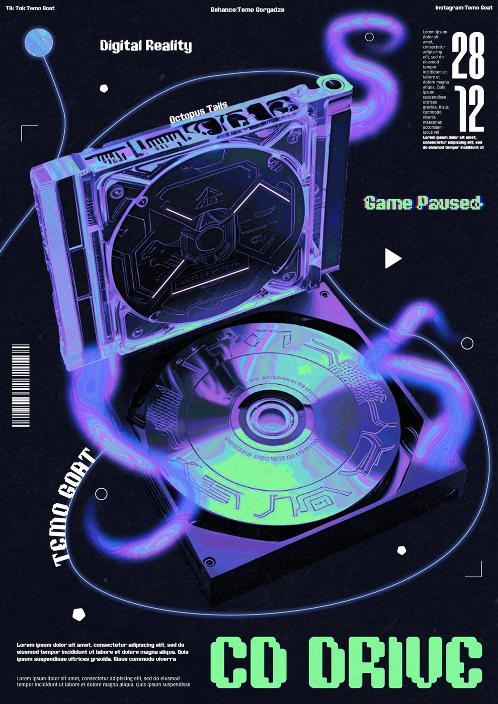

# 05 — Cyber / Techno HUD

**1 gambar.** Objek 3D iridescent dikelilingi tendrils neon dan diapit tipografi teknis.

---

## `vr-cddrive-cyber-hud`

CD drive terbuka dengan disc iridescent, dikelilingi **tendrils cairan neon biru-ungu** yang
melingkari objek seperti pita. Latar navy-hitam.

- **palet** — `#0A0E1A` ground / `#3A5CF0` biru elektrik / `#8B3FE8` ungu / `#7CFF5C` hijau neon /
  `#2FD8CF` cyan
- **tipografi** — empat register sekaligus: mono kecil di header (tiga titik: kiri/tengah/kanan),
  angka condensed besar `28 / 12`, display pixel-font hijau neon `CD DRIVE` di dasar, dan teks
  rotasi 90° di tepi kiri
- **elemen HUD** — barcode, crop marks di sudut, lingkaran outline, segitiga play, poligon kecil
  yang tersebar sebagai penanda
- **komposisi** — padat, hampir tanpa ruang kosong. Objek center, tipografi mengisi seluruh margin.

---

## Aturan yang diturunkan

- **Yang diadopsi**: perbendaharaan HUD — mono uppercase tracking lebar, angka tabular, crop marks,
  label metadata di empat sudut. Ini yang dipakai di `hero-explore-3` untuk readout frame time.
- **Yang TIDAK diadopsi**: kepadatannya. Poster A3 bisa menahan 12 elemen tipografi sekaligus;
  hero fullscreen tidak. Aturan repo "negative space as design element" menang.
- **Pixel font ditolak** — belum pernah ada di repo, dan menambah famili kelima melanggar batas
  ≤2 famili teks.
