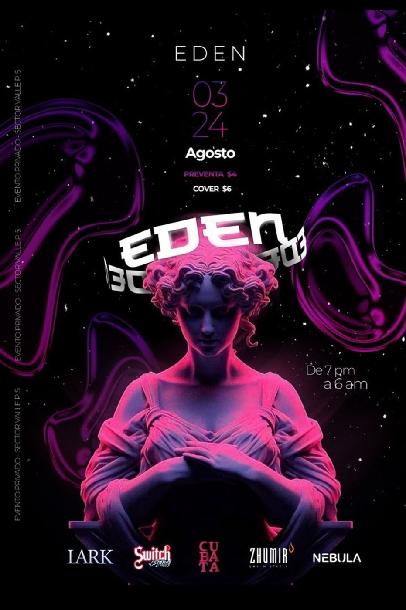
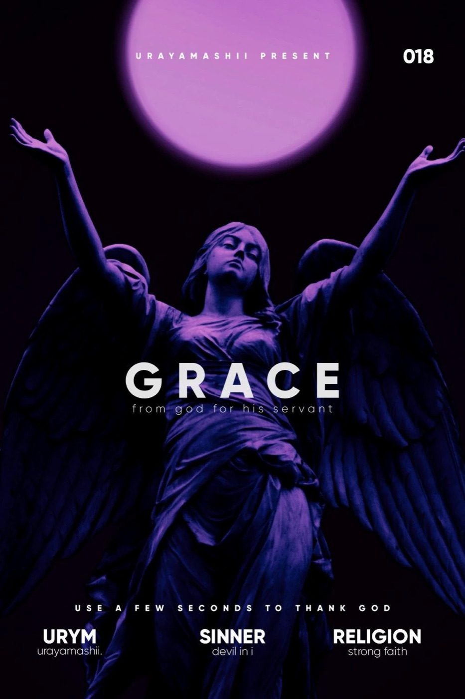

# 06 — Sculptural Neon

**2 gambar.** Patung klasik (marmer, Yunani/Romawi) diberi pencahayaan neon dan duotone.

---

## `vr-eden-sculpture-neon`

Patung wanita klasik duduk bersila, diberi rim-light magenta dari kiri dan biru dari kanan, di atas
hitam berbintang. Liquid chrome tendrils ungu-magenta melayang di belakang. Wordmark `EDEN` chrome
dengan mirror reflection di bawahnya.

- **palet** — `#050508` / `#2B0B4E` / `#8B2BC8` / `#E8409C` magenta / `#3A5CF0` biru / `#F0E8F5`
- **teknik** — dua sumber cahaya berlawanan warna (split lighting), starfield, chrome wordmark
  dengan refleksi cermin

## `vr-grace-angel-duotone`

Patung malaikat bersayap difoto low-angle dengan **disc cahaya solid** di belakang kepala sebagai
halo — satu-satunya sumber cahaya. Duotone: shadow → plum gelap, highlight → violet-magenta.

- **palet** — `#0B0208` / `#1E0A22` / `#4B2A7A` / `#7B4FC0` / `#C86BE0` disc / `#F2EDF5` teks
- **tipografi** — grotesk geometrik uppercase dengan **tracking positif ekstrem** (~0.35em untuk
  display, ~0.4em untuk kicker) — kebalikan dari tracking negatif yang dominan di library situs
- **komposisi** — center-anchored simetris, angka `018` counter-positioned di kanan-atas melawan
  kicker kiri
- **shader** — duotone remap luminance ke gradient dua-stop `#1E0A22` → `#C86BE0`, plus radial glow
  terpisah di-`screen` blend dengan falloff `pow(1.0 - dist, 2.5)`

---

## Aturan yang diturunkan

- **Satu sumber cahaya lebih kuat dari tiga.** `vr-grace-angel-duotone` hanya punya halo di
  belakang kepala dan hasilnya lebih tegas daripada split-lighting dua warna di
  `vr-eden-sculpture-neon`.
- **Tracking positif ekstrem sah untuk display uppercase pendek** (satu kata, ≤6 huruf) di atas
  ground gelap. Untuk kalimat, tetap tracking negatif.
