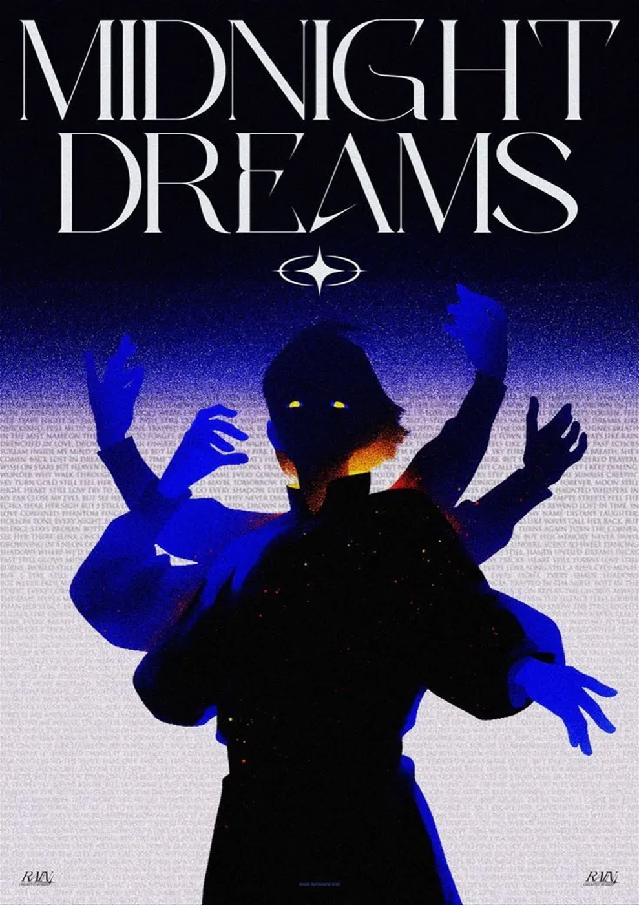

# 07 — Editorial Poster

**2 gambar.** Poster tanpa thermal, tanpa liquid — kekuatannya murni dari tipografi dan gradien
bergrain.

---

## `vr-midnight-didone`


Display serif Didone putih `MIDNIGHT DREAMS` dua baris mengisi sepertiga atas, di bawahnya
ilustrasi figur bertangan banyak dengan siluet gelap dan tangan biru elektrik. Gradient noise
biru → putih dari atas ke bawah.

- **palet** — `#0A0A2E` / `#1E1E8C` / `#2B2BE8` biru elektrik / `#8888C8` / `#FFFFFF`
- **teknik** — gradient dengan **dither noise kasar** pada transisi (bukan gradien mulus);
  micro-copy dipakai sebagai **tekstur latar** — ribuan kata kecil membentuk bidang abu-abu
- **tipografi** — Didone high-contrast, weight regular, uppercase, tracking mendekati 0, dua baris
  dengan baris kedua sedikit lebih lebar. Glyph bintang/sparkle sebagai pemisah.
- **catatan** — satu-satunya gambar di koleksi ini yang groundnya **berakhir terang** di bawah

## `vr-freedom-marble-isoline` (juga terdaftar di kategori 01)

Dimasukkan ulang di sini untuk struktur tipografinya, yang paling siap diadopsi:

```
WHERE THE SPIRIT IS —          eyebrow, uppercase, bold, tracking longgar, kecil
THERE IS FREEDOM.              headline, uppercase, bold, besar
flowing, living, uncontainable.  subline, italic, regular
@handle        2 COR 3:17        RUACH      footer 3 kolom, uppercase, kecil
```

Empat tier dalam satu blok kiri-bawah, plus footer tiga titik di tepi. Rasio ukuran eyebrow :
headline ≈ 1 : 3.2.

---

## Aturan yang diturunkan

- **Micro-copy sebagai tekstur** adalah teknik yang belum ada di repo dan layak dicoba: teks
  berukuran 6–8px yang membentuk bidang abu-abu, dibaca sebagai material bukan sebagai kalimat.
- Struktur eyebrow → headline → subline → footer-3-kolom adalah lockup paling ringkas untuk
  menyampaikan hierarki dalam satu sudut layar. Dipakai di `hero-explore-3` untuk blok HUD.
